# Unlocked — design system

How the Mini App looks, and how to make something new look like it. The
system is design E, "Expressive" (owner, 2026-10-26): Material 3 Expressive's
language — tonal colour, shapes that carry meaning, a type face whose width is
a voice, springy motion — in the app's own palettes. What the app does is
`docs/mini-app-spec.md`; this file is only the look.

**One source.** Every value lives in `webapp/src/styles/tokens.css`; every
control is a component in `webapp/src/ui/`. A screen composes those and never
styles a control of its own: no colour, radius, font size or shadow written in
a screen's CSS that a token or a component already says. When a screen needs
something the system lacks, add it to the system first (a token, a component,
a class in `ui.css`), then use it.

## Colour

Tonal roles, as Material 3 names them. Each role has its "on" colour for what
sits on it; use the pair, never a role's colour on a surface it was not made
for.

| role | for |
|---|---|
| `--surface` | the page |
| `--surface-1` … `--surface-4` | raised layers: a card (1), a field or a quiet button (2–3), a pressed or a hovered state (4) |
| `--on-surface`, `-2`, `-3` | text: main, secondary, a meta line |
| `--outline`, `--outline-soft` | an outlined control's edge; a divider |
| `--primary` / `--on-primary` | the one action that matters on a screen, a selected state, a link, a mark of rarity |
| `--primary-container` / `--on-primary-container` | a hero block, a selected tab, a selected segment |
| `--secondary-container` / `--on-secondary-container` | a tonal button, a selected list choice, the «Патч» mark |
| `--tertiary` / `--on-tertiary` | the accent: the search button, what is complete (100 %, a done mark) |
| `--tertiary-container` / `--on-tertiary-container` | a completed card's ground, the «Новость» mark, «вместе» |
| `--error` / `--on-error` | a danger action, an error |
| `--bronze`, `--silver`, `--gold`, `--platinum` | a PSN game's trophy counts by metal on its list page, nowhere else |

**Where each role goes — and nowhere else** (owner, 2026-10-27: no colour
of its own on a button or a line):

| what | colour |
|---|---|
| the page; a card, a row, a tile, a link card | `surface`; `surface-1` |
| a field, a quiet chip or button, a pressed state | `surface-3` |
| a track, an empty face | `surface-4` |
| the one main action; progress; a link; "playing" | `primary` |
| what is selected (a segment, the bar's pill, today); a hero card; the round "go" mark; a toggle that is on (favourite) | `primary-container` |
| a tonal button; a state (following, friends, unread); the «Патч» mark | `secondary-container` |
| done — 100 %, a done mark, a list earned whole; the search button | `tertiary` / `tertiary-container` (and «Новость») |
| danger, an error | `error` |
| rarity and rank | the tiers, below — never `primary` or `tertiary` |
| a platform's mark | `--xbox`, `--psn`, `--steam` |
| a shadow; text over a picture | `--shadow-1`, `--shadow-2`; `--img-scrim` with white text |

Chips are four kinds: `chip-outline` (a fact: a genre, points),
`chip-tonal` (a link out: a store page, with ↗), `chip-secondary` (a state),
`chip-tier-rare|legendary|mythic` (rarity). A mark in a card's corner (go, done) is
40 px, 16 px in from the corner. Buttons:
`filled` (one per screen), `tonal`, `text`, `danger`; icon buttons `tonal`,
`plain`, `glass`. Nothing else exists; a screen needing another asks first.
A game's page takes its scheme from its art, so on it a toggle or a mark
uses the scheme's roles (`primary-container`), never the shared pink.

**Palettes.** Seven, picked in Settings → Appearance («Внешний вид») and kept on the
device (`app/env.ts::look`, `localStorage`): **Violet** (the default, the
logo's lilac with a pink accent), **Mint** (teal with coral), **Amber** (warm
orange with coral), **Ocean** (blue with gold), **Rose** (pink with blue),
**Graphite** (neutral grey with cyan), **Halloween** (pumpkin orange on a night
nearly black, with a witch's purple). Violet is always open; the others are
the season pass's rewards (`core/season-pass.ts`). Each has a dark and a light form; the mode is Auto
(Telegram's own scheme inside it, the system's elsewhere), Light or Dark. A
palette is one block of tokens in `tokens.css` under
`:root[data-palette="…"]` and its `[data-theme="light"]` twin — a new palette
is two such blocks and a swatch, nothing else. **A game's page takes a muted
scheme from its own art** (`app/artTheme.ts`), over whichever palette is on,
and so do the pages inside it — its achievements, one achievement, its
gallery, a post of its (`rememberGameArt` / `gameArtOf`: the same picture,
so the same colours). The colour is the picture's **dominant** one (the
busiest hue, not the average of all of them), as strong as the picture is
vivid. **A season's cover colours its month card in a deeper form** (owner,
2026-10-30; `useArtTheme(url, true)`; the pass page takes the game page's
muted scheme): the containers
and the cards inside sit halfway in its colour, with light text, since an
orange or a yellow held as dark as the page is only brown — the one place
cards are not `surface-1`. The month card does so on Home and on a person's
page, each month in its own season's colour; the page's ground stays muted.

Platform marks keep the platforms' own colours (Xbox green, PlayStation blue,
Steam slate); nothing else is coloured outside the tokens.

## Type

Roboto Flex, variable. **Width is a voice**: numbers are narrow and heavy
(`font-stretch` 30–60 %), headlines wide (110–120 %), body text normal.

| class | size / weight | for |
|---|---|---|
| `.t-display` | 112 / 850, narrow | one hero number per screen |
| `.t-headline` | 40 / 800, wide | a tab's title (Лента, Рейтинг) |
| `.t-title` | 22 / 700, wide | a section's title, a page's name |
| `.detail-title` | 28 / 800, wide | the title of a post, a news post, an achievement |
| `.t-card` | 20 / 800, wide | the title of a feed card |
| `.t-label` | 16 / 650 | a row's title, a card's name |
| `.t-body` | 15 / 400 | running text |
| `.t-meta` | 13 / 400, `--on-surface-3` | dates, counts, sources |
| `.t-num` | narrow, 800 | any number shown as a value |

**Points are a coin** (owner, 2026-10-29; `PointsCoin`): the logo's
sparkle (`--tertiary`) and the number beside it, no ground — never «20 очков» after an achievement. Totals (a month's, a list's)
stay a number with its word.

Lists of achievements write their worth as one meta line (the coin, then `6,3 %`, `AchMarks plain`), rarity coloured by how rare; chips are for
filters and states, not for every value.

## Space and shape

- **Spacing** is a 4-point scale (`--s-1` 4 … `--s-8` 32). The page's side
  margin is `--gutter` (16). A section (`Section`) opens 28 above its title;
  inside a card 14–16; between rows of one group 3.
- **Radii**: `--r-xs` 6 (inner corners of connected items), `--r-s` 12,
  `--r-m` 18, `--r-l` 28 (a card), `--r-xl` 36 (a hero card), `--r-full`
  (buttons, chips, pills).
- **Connected groups**: items of one group sit 3 apart, their inner corners
  small (6–8) and the group's outer corners large (`--r-l`) — rows of settings
  (`Group` + `Row`), the counts on a profile, the achievements of a list, the
  game and the person under an achievement. No hairlines between items: the
  gap and the ground part them. A segmented choice (`Segmented`)
  and a split button (the follow button and its menu) join the same way.
- **Shapes carry meaning** (`styles/shapes/`, masks — a class `shape-<name>`
  on any block). One shape, one job; a new thing takes the shape of its job,
  never a new shape for its looks:

  | Shape | Its job | Where |
  |---|---|---|
  | `cookie12` | a person | `Face`, its presence ring, a face's skeleton |
  | `cookie9` | an action or a mark in an icon | icon buttons (the heart, `GoMark`), platform marks, a theme's swatch, settings' leading icons |
  | `flower6` | rarity, a place, done | the rarity badge (`AchRow`, `AchTile`), the place medal (month card, Ranking), `DoneMark` |
  | `sunny8` | something to take now | a pass reward ready to claim (its node) |
  | `gem` | a prize from the organiser | a prize's node on the pass timeline |
  | `burst12` | where one is now | «Ты здесь» on the pass timeline |
  | `puffy` | nothing here yet | the mark of `Empty` |
  | `clover4` | decoration only | behind the hero cards (`home-hero-deco`) |

  A face is always a cookie; a game's cover always a rounded rectangle (or a
  circle inside the progress ring); never mix the two. The shapes are drawn by
  one rule — 360 points of a smooth outline on a 100×100 box — so a new one
  sits with the rest.
- **Progress is a wave**: `Wave` on a line, `WaveRing` around a cover. Full is
  all wave, in `--tertiary`.

## The rarity tiers — our Fortnite note

What is rare is drawn as a tier, as a game's item card is (owner, 2026-10-27),
one scale for the whole app, fixed in every palette: **mythic** green
(`--tier-mythic`), **legendary** orange (`--tier-legendary`), **rare** purple
(`--tier-epic`). An achievement takes it the same way on every platform
(`views.rareLevel`): mythic — Xbox's Mythic and PSN's platinum —, legendary at
1 % and under, rare at 10 % and under, else none. A PSN trophy's metal
(bronze, silver, gold) is not shown in the app: its tier says how rare it is.
A picture is never framed or tinted by its tier: rarity shows on its badge;
a feed card takes a bare wash of it. Places take the same colours: first
mythic, second legendary, third rare (the podium, the leaders' marks). Use
the tiers for rank and rarity only.

**Points are the app's own** (owner, 2026-10-27): an achievement is worth
its tier — common 10, rare 20, legendary 30, mythic 100 (`views.POINTS`, the
server's `_sql.points`) — on every platform, in place of Xbox's G. Rankings,
the month card and the share of the circle count points. Tens leave room for
a step between.

## The feed's card

The feed — and a person's recent achievements — is a magazine (owner,
2026-10-27; `parts/MagazinePost.tsx`):
one card per post, apart from the next (14 below it), on `--surface-2` (a
shade above other cards, so each post stands on its own),
`--r-l`, its picture `--r-m` inside it. Its order is what the reader looks
for: who (a face, two side by side for «вместе»; the name `.t-label`, the
game under it `t-meta`) and when (`t-meta`, right); the achievement's picture
with its rarity flower on the corner — and the handshake (`tertiary-container`)
beside it for an unlock got together —; a meta line (the tier's word in its
colour, then the points), the name (`.t-card`), what it asks (two lines); the
post's other achievements as a rail of pictures with their names and
rarities. A rare, legendary or mythic card takes the barest wash (6 %) of its
tier's colour; no frame, no gradient. A favorite game's news
is the same card: the game in the person's place, «от разработчиков», the
kind (a wrench, a newspaper) in the flower's place, «Патч» / «Новость» on the
meta line; with no picture of its own, the game's cover on its blurred self.

## Motion

Every page enters the same way — from the right, a short way, out of a fade —
and leaves back the same way, quicker; the page under it steps back a little
(a transform only — no filter on a whole page, it stutters). A tab
rises in. The bar's pill slides from tab to tab. Springs, not eases: `--spring` for a press or a pop, `--spring-soft` for a
layer arriving; `--t-fast` 160, `--t-mid` 280, `--t-slow` 420 ms. A pressed
button squares its corners (`border-radius` to `--r-m`) and shrinks 3 %. A
done mark and a heart pop (`heart-pop`). Reduced motion keeps only fades.

## Components (`webapp/src/ui/`)

| component | use |
|---|---|
| `Page` | every layer over the tabs: its bar (back, title, actions), its scroll. `hero` makes the bar see-through over a picture until the page scrolls |
| `Hero` | the head of a page about one thing — a post, a news post, an achievement, a list: the picture on a blurred ground of itself; `full` runs it edge to edge |
| `Section` | a titled block of a page, its action on the right |
| `Group`, `Row` | connected rows: lead (icon, face, cover), title, sub, trail, chevron |
| `Button` | filled (one per screen), tonal, outline, text, accent, danger; `wide` for a full-width one |
| `IconButton` | a round icon action; `glass` over a picture |
| `Segmented` | two to four mutually exclusive choices |
| `Chip` | a filter or a state |
| `Toggle`, `Field` | settings and forms |
| `Sheet`, `Confirm` | a menu of actions; a question before something that cannot be undone |
| `Face`, `Cover`, `AchPic` | a person; a game's or a post's picture; an achievement's picture (with the small-picture rule) |
| `Wave`, `WaveRing` | progress |
| `LinkCard` | a way to somewhere else — the game of a post or an achievement, a guide video: picture, title, a line, a round mark of where it goes |
| `AchTile` (parts) | one achievement as a card of a rail — Home's latest, the hunts, the rare finds; people under it or what it is worth; a rarity flower when asked |
| `.translating` | a text whose translation is on its way, in place, blurred: the page asks again and the blur goes |
| `Empty`, skeletons (`.skel`, `MagazineSkel`) | nothing yet; on its way — a skeleton has the shape of what will come, never a spinner in the middle of a screen |
| `Viewer` (`openImage`) | a picture or a trailer full screen; a list of them — a game's gallery, trailers and pictures together — slides |
| `RichText` | a post's or a guide's text: paragraphs, lists, links (bare addresses too), pictures, videos |
| `BottomBar`, `Toast` | the tabs and the search; a short notice |

Shared parts of several screens are `webapp/src/parts/` (the feed's card —
a post or a news post, `MagazinePost` — and its skeleton, also a person's
recent achievements, an achievement row, the month's
games, months, favorite games, the follow button, the kind mark — «Патч» /
«Новость», one look everywhere —, the game link, the account row).

**The season pass is headed as an achievement is** (owner, 2026-10-28):
`Page hero` over a `Hero full` — the month's cover edge to edge, the months'
arrows as `glass` buttons on it —, a `flower6` on its corner with the days
left where an achievement wears its rarity (`primary`), then a
`chip-secondary` «Сезон · Октябрь» and the season's name as `.detail-title`;
«Ты здесь» is a `primary-container` card on its timeline, one line of what
the next level still needs.

**A page about a list of one thing** — a game's achievements, its gallery —
is the same page: `Page hero` over a `Hero` (the cover on its
blurred ground, in its `WaveRing` where there is progress, its name, the
count; its classes `.list-ring`, `.list-cover`, `.list-name`, `.list-stats`
are in `ui.css`), then a sticky `.list-filter` with a `Segmented`
(it stays under the collapsed bar on a solid ground), then the list. A
section that shows a part of a long list gives its whole as such a page
(«Все N»), not as a sheet. Home's month card counts by day as bars
(`MonthBars`), today marked, the days to come faint.

## Actions and links — one rule

- **A link of its own** (the game of a post or an achievement, a person who
  got it, a video): `LinkCard` — picture, title, a line, and a round
  `primary-container` mark of where it goes (forward, play). Several in a row
  join as one group (`.link-cards`).
- **A page's own action rides up into its bar once the page scrolls**
  (owner, 2026-10-27; `BarAction` in `ui/Page.tsx`): a compact twin of it —
  following a person, a game's heart — appears in the bar's right corner, so
  the action stays a tap away. The app's way for every page with an action in
  its head; a new one wraps its twin in `BarAction` and nothing else.
- **A row of a settings group** goes on with a plain chevron (`Row chevron`).
- **A card that is itself the way in** (the progress card of a game) carries
  the same round mark in its corner, never a second button saying the same.
- **One main action per screen** is a filled `Button`; a toggle of state
  (the game's heart) is a round mark that turns its page's `primary` when on
  — the game's own colour —, and rides up into the bar once the page scrolls.
- **Who has it** in a list row is a pair of small faces at the end of the
  meta line, the one who lacks it faded — never a column beside the row.

## Making something new

1. Find the closest existing screen and copy its structure: `Page` (or a tab's
   `screen-head`), then `Section`s of `Group`s, cards and rails.
2. Pick roles, not colours: a card is `--surface-1`; what is selected is
   primary-container; what is done is tertiary.
3. Text from the type table; numbers `.t-num`; nothing under 12 px.
4. Every list that loads has a skeleton of its own shape; every empty list an
   `Empty` with what to do.
5. Check it in all three palettes, dark and light, at 390 px wide, inside
   Telegram and in a browser.

## What it looks like

Real screens, 390 px wide, rendered from the dev server (`docs/design-system/`).
Re-render them when a screen changes its shape.

| | | |
|---|---|---|
| 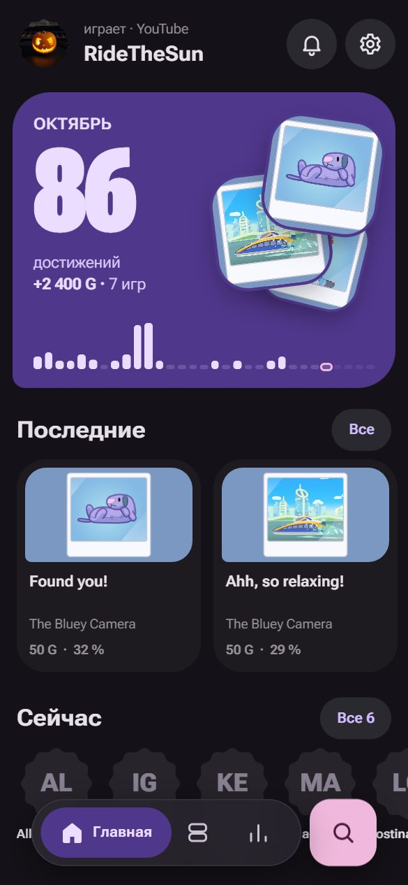 Home — Violet, dark | 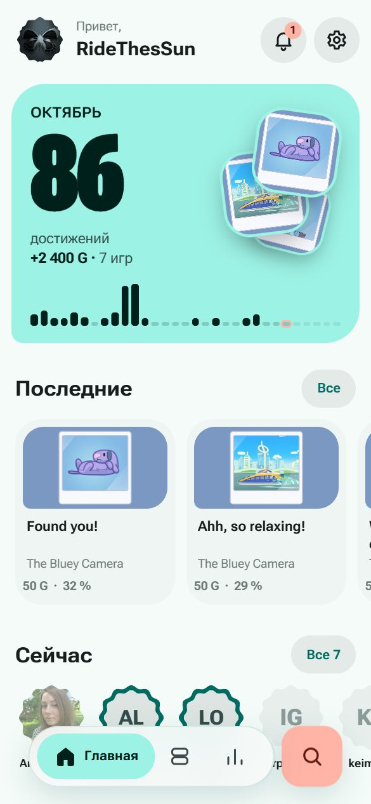 Home — Mint, light | 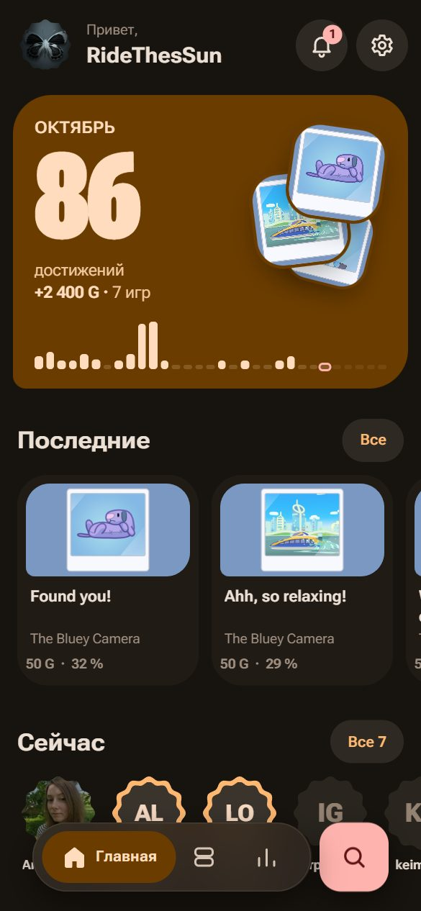 Home — Amber, dark |
| 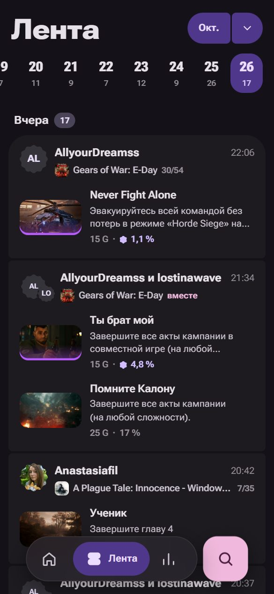 Feed: posts, the days strip, a news post | 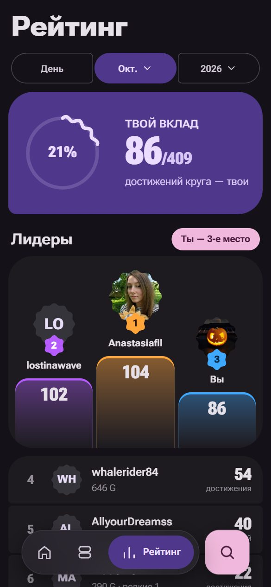 Ranking: day · month · year, your share | 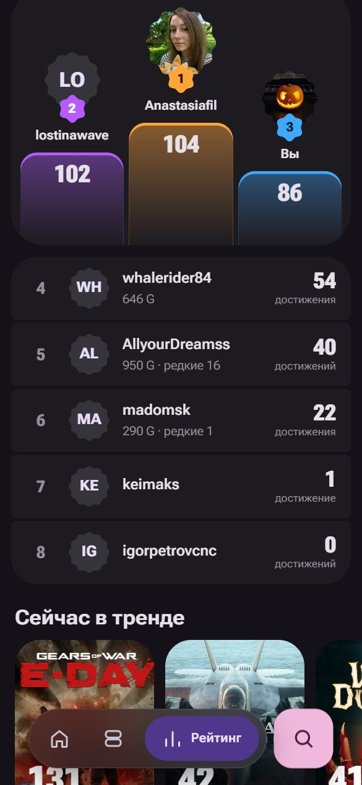 The top three, then rows |
| 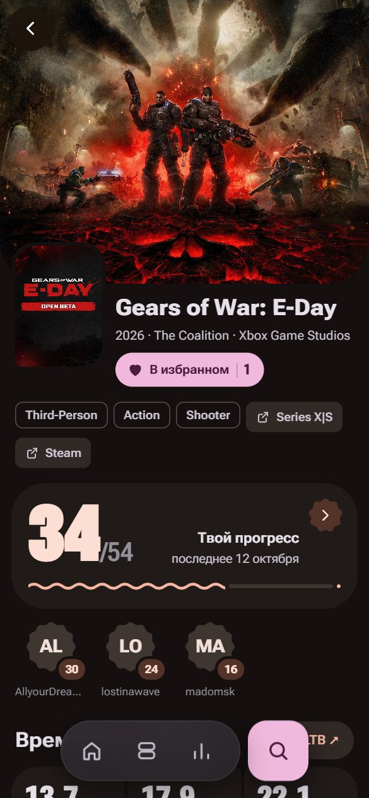 A game: its art, its scheme, the heart | 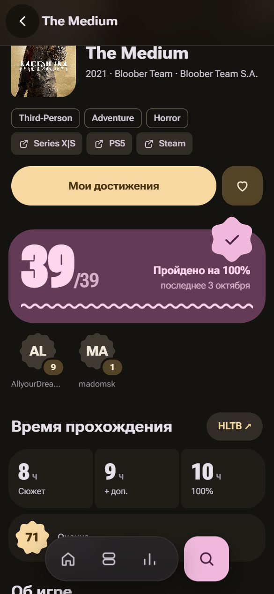 A game earned whole | 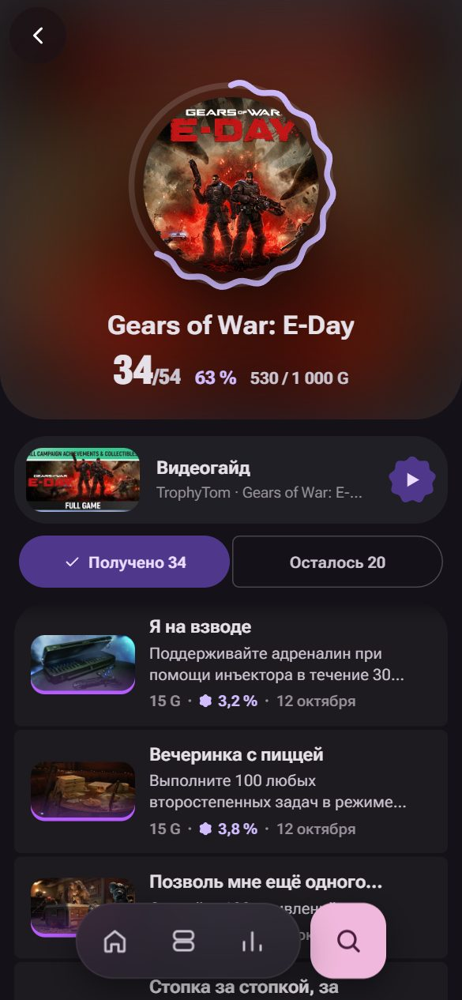 A list page: ring, guide, sticky filter |
| 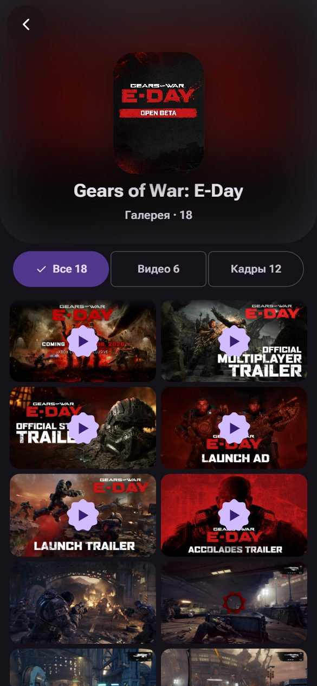 The gallery page | 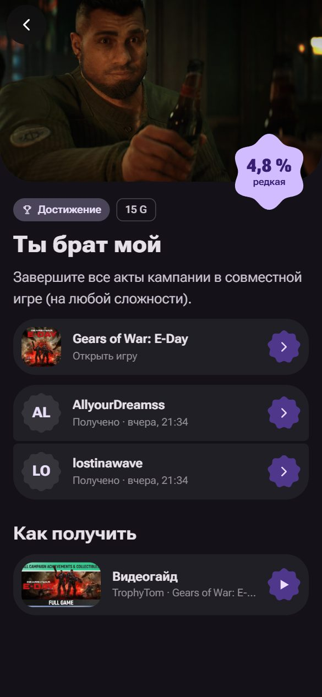 An achievement earned together | 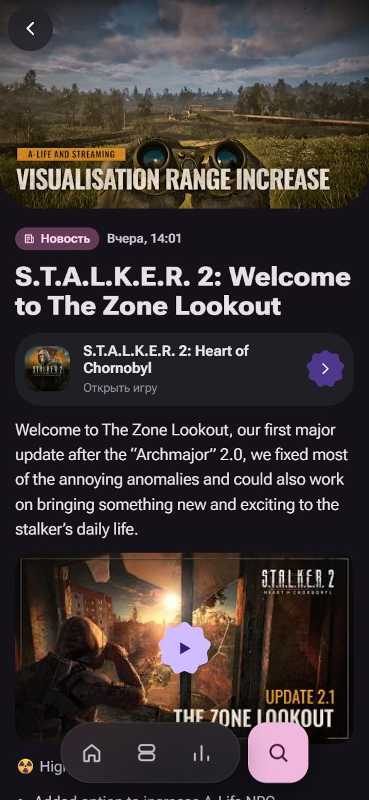 A news post |
| 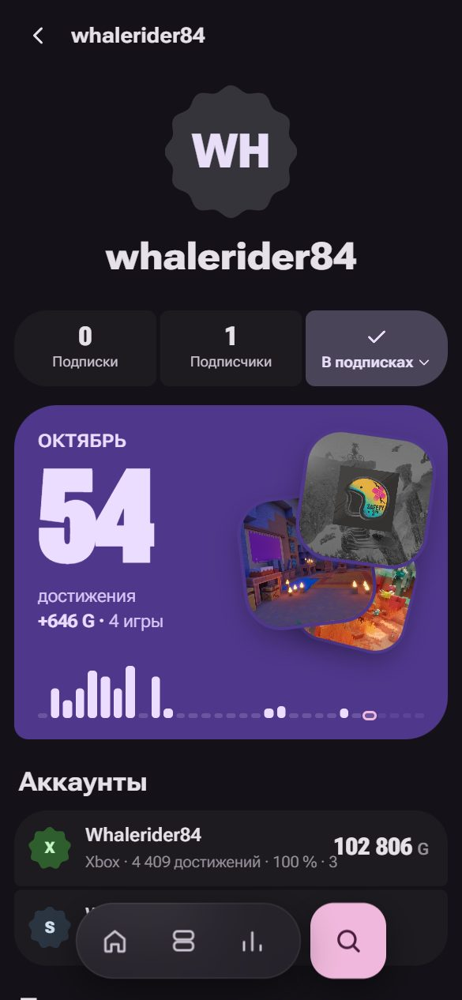 A person | 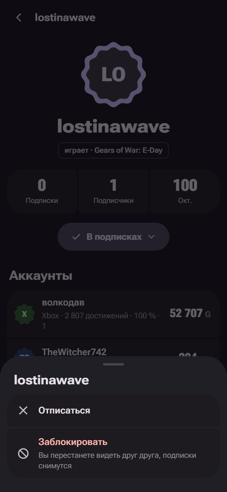 A sheet of actions | 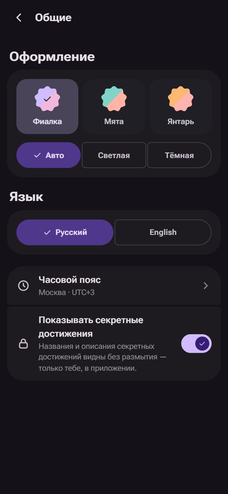 Settings: palettes and mode |
| 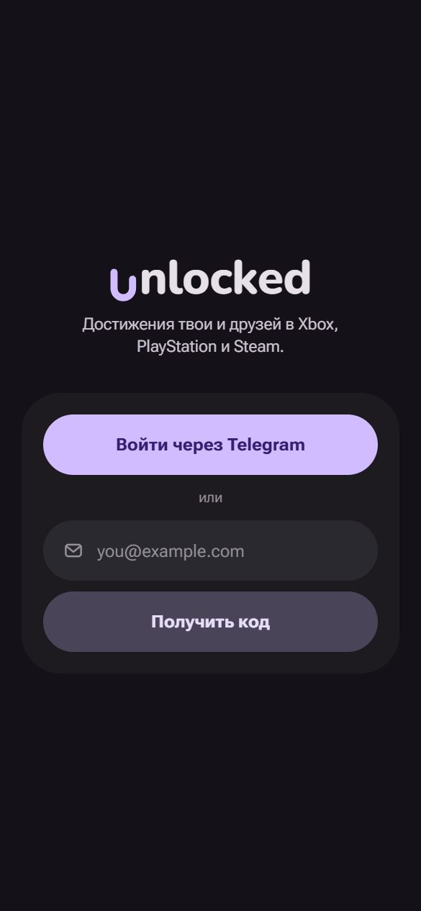 Sign-in | | |
